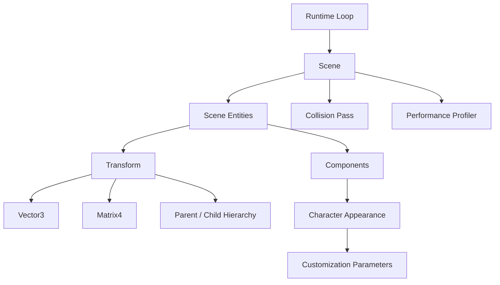

# C++ 3D Character Customization Runtime

[](https://github.com/Osman-mohamad-eng/character-runtime/actions/workflows/ci.yml)
[](https://github.com/Osman-mohamad-eng/character-runtime/releases)

A **C++17 3D character and scene runtime** implementing hierarchical transformations, character customization, collision bounds, automated testing, and runtime performance profiling.

The project explores core systems used in real-time applications and game technology, including vector and matrix mathematics, local/world coordinate spaces, scene hierarchies, component-based entities, runtime updates, collision detection, and performance measurement.

## Features

- `Vector3` arithmetic, normalization, magnitude, dot products, and cross products
- Row-major `Matrix4` transformations and matrix composition
- Point and vector transformation
- Matrix inversion
- Translation, Euler rotation, and non-uniform scaling
- Local-space and world-space coordinate conversion
- Hierarchical parent/child transforms
- Cached local and world matrices with invalidation propagation
- Scene entities with modular updateable components
- Configurable character body dimensions and RGB skin-color parameters
- Fixed runtime update loop
- Bounding-sphere collision checks
- Transform-update performance profiling
- Configurable many-entity benchmark scene
- Automated testing with GoogleTest
- Continuous integration with GitHub Actions

## Architecture



The `RuntimeLoop` drives a `Scene`, which owns the entities participating in each runtime update.

Each entity owns a `Transform` and may contain modular components. Character entities extend this structure with appearance and customization data.

Transforms maintain local and world matrices. Changes to a parent transform invalidate dependent child transforms, allowing hierarchical transformations while avoiding unnecessary matrix recomputation.

Bounding spheres are transformed into world space and used by the scene's collision pass.

For a more detailed discussion of implementation decisions, see [`docs/architecture.md`](docs/architecture.md).

## Core Systems

### Vector and Matrix Mathematics

The runtime provides dedicated `Vector3` and `Matrix4` classes for the mathematical operations required by the scene system.

Supported operations include:

- Vector addition and subtraction
- Scalar multiplication
- Magnitude and normalization
- Dot products
- Cross products
- Matrix multiplication
- Translation
- Rotation
- Scaling
- Coordinate transformation
- Matrix inversion

These classes provide the mathematical foundation for object placement and motion in 3D coordinate spaces.

### Hierarchical Transform System

Each entity contains a transform supporting:

- Position
- Rotation
- Scale
- Local-space transforms
- World-space transforms
- Parent-child relationships

World transforms are calculated by composing an entity's local transform with its parent's world transform.

Cached transformation matrices are invalidated only when necessary, reducing redundant calculations when scene objects remain unchanged.

The hierarchy also includes cycle checks and safe detachment behavior.

### Character Customization

Character entities contain configurable appearance data such as:

- Body dimensions
- Scale parameters
- RGB skin-color values

Customization values are validated before being applied to runtime character state.

This separates character data from the underlying transformation system and provides a foundation that could later support meshes, animation systems, or user-generated character content.

### Scene and Runtime Updates

The scene owns entities and coordinates their updates during each runtime tick.

A typical update includes:

1. Updating entity components
2. Resolving hierarchical transforms
3. Updating world-space collision bounds
4. Detecting bounding-sphere overlaps
5. Recording performance measurements

This keeps scene ownership, entity behavior, transform calculation, and profiling responsibilities separated.

## Collision Detection

The project includes world-space bounding-sphere collision checks.

The current collision implementation performs a straightforward **O(n²)** pair comparison. This provides a simple and explainable baseline for validating runtime behavior.

For significantly larger scenes, potential extensions include:

- Spatial hashing
- Uniform grids
- Bounding volume hierarchies
- Broad-phase collision systems

## Project Structure

```text
character-runtime/
├── benchmark/
│   └── Performance benchmark executable
├── docs/
│   └── Architecture and design documentation
├── include/
│   └── runtime/
│       └── Public runtime APIs
├── src/
│   └── Runtime implementations
├── tests/
│   └── GoogleTest unit tests
├── .github/
│   └── workflows/
│       └── ci.yml
├── CMakeLists.txt
└── README.md
```

## Testing

The project uses **GoogleTest** to validate core runtime behavior.

The test suite covers areas including:

- Vector arithmetic
- Vector normalization
- Dot and cross products
- Matrix transformations
- Translation, rotation, and scaling
- Local/world coordinate conversion
- Hierarchical parent-child transforms
- Character customization
- Collision behavior
- Profiling validation
- Runtime update behavior

The current test suite contains **20 passing tests**.

Tests are also executed automatically through **GitHub Actions** on pushes and pull requests targeting `main`.

## Continuous Integration

The repository includes a GitHub Actions workflow that automatically:

1. Checks out the repository
2. Configures the project with CMake
3. Builds the C++ runtime in Release mode
4. Executes the complete CTest suite
5. Reports test failures directly through GitHub

This provides automated build and regression-test validation for changes to the runtime.

## Performance

The runtime includes a configurable benchmark for measuring hierarchical transform-update performance across large scenes.

A validated local benchmark produced:

| Configuration | Scene Size | Update Iterations | Average Transform Update |
|---|---:|---:|---:|
| Debug | 10,000 entities | 20 | 2.747 ms |

The profiler invalidates cached world matrices before each measured sample so the benchmark captures actual transform recomputation.

Performance results vary depending on:

- CPU
- Compiler
- Optimization settings
- Build configuration
- Scene hierarchy

For meaningful comparisons, benchmarks should be performed on the same machine using the same build configuration.

## Build

### Requirements

- CMake 3.16 or newer
- C++17-compatible compiler
- Git
- Network access during the initial CMake configuration to fetch GoogleTest v1.14.0

On Windows, a Visual Studio C++ workload or another C++17-compatible toolchain is required.

### Clone

```bash
git clone https://github.com/Osman-mohamad-eng/character-runtime.git
cd character-runtime
```

### Configure

```bash
cmake -S . -B build -DCMAKE_BUILD_TYPE=Release
```

### Build

```bash
cmake --build build --config Release
```

## Run Tests

```bash
ctest --test-dir build -C Release --output-on-failure
```

Testing can be disabled when configuring the project:

```bash
cmake -S . -B build -DBUILD_TESTING=OFF
```

## Run the Benchmark

The benchmark accepts optional entity and iteration counts.

The default workload is:

- **10,000 entities**
- **20 measured update iterations**

### Linux / macOS

```bash
./build/character_runtime_benchmark 10000 20
```

### Windows PowerShell

```powershell
.\build\character_runtime_benchmark.exe 10000 20
```

Visual Studio multi-configuration builds may place the executable inside the configuration directory:

```powershell
.\build\Release\character_runtime_benchmark.exe 10000 20
```

## Engineering Focus

This project focuses on several areas relevant to real-time systems and game technology:

- Modern C++ software design
- Object-oriented architecture
- 3D vector and matrix mathematics
- Hierarchical coordinate transformations
- Scene and entity systems
- Character customization
- Runtime update loops
- Collision detection
- Cache-aware transform updates
- Automated testing
- Continuous integration
- Performance profiling and benchmarking

The runtime is intentionally focused enough for its systems and trade-offs to remain understandable while providing clear extension points for more advanced functionality.

Possible future extensions include:

- Renderer integration
- Mesh and skeletal animation systems
- Broad-phase collision detection
- Parallel transform updates
- Asset loading
- Runtime serialization
- User-generated character content

## Release

The current public release is:

**v1.0.0 — Initial Public Release**

It includes the core math library, transform hierarchy, scene/entity architecture, character customization system, collision bounds, automated testing, and runtime performance profiling.

See the [Releases](https://github.com/Osman-mohamad-eng/character-runtime/releases) page for release information.

## License

This educational portfolio project does not bundle third-party source code.

GoogleTest is downloaded by CMake during configuration and remains subject to its own license.
